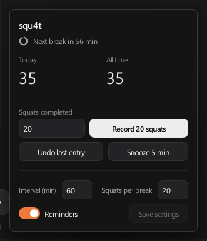
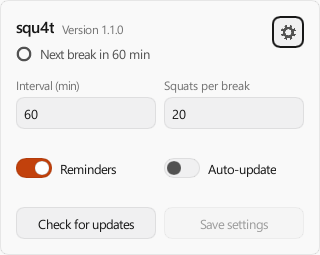

# squ4t

Squat reminders, a live tray countdown, and daily/all-time rep tracking for Windows 10 and 11.
The logic of [omarchy-squat-break](https://github.com/braga1k/omarchy-squat-break), written in
Rust with Slint.



## Download

Get the zip of the [latest release](https://github.com/braga1k/squ4t/releases/latest)
(`squ4t-<version>-windows-x64.zip`), unzip it anywhere and run `squ4t.exe`. There is no installer
and nothing else to install. From 1.1.0 on, the app can update itself: see [Updates](#updates).

The executables are not code-signed, so Windows SmartScreen may warn the first time: choose
**More info → Run anyway**. Each release lists the SHA-256 of the zip, to check it with
`Get-FileHash` on the zip.

The tray icon is a ring that empties as your next break approaches. It fills with ember orange
when a break is due, and shows a pause sign while reminders are paused. Hover over it for the
countdown and your totals. Click it to open the panel: the two counts, Record, Undo and Snooze.
The cog in its corner opens the settings.

## Use

| Control | Action |
| --- | --- |
| Click the tray icon | Open or close the panel |
| Right-click the tray icon | Menu: Open, **Pause / Resume** (the default), Snooze 5 min, Start with Windows, Exit |
| **Record … squats** | Add the confirmed number to today's count and the all-time total. The number is a field inside the button: click it to type another, or step it with Up and Down |
| **Undo last entry** | Remove the last confirmed entry, even after midnight |
| **Snooze 5 min** | Move the next reminder five minutes ahead |
| The cog | Swap the counts for the settings, and back |
| **Reminders** switch (settings) | Pause, or resume from the time that was left |
| **Save settings** | Apply the interval (1–1,440 min) and squats per break (1–1,000). Off while nothing has changed |
| **Check for updates** | Look for a newer release; when there is one the button becomes **Update to …** |
| **Auto-update** switch | Off at first. On: one look a day, and a newer release is installed by itself |
| Click a reminder | Open the panel |
| Escape | Close the panel |

The defaults are a reminder every 60 minutes, suggesting 20 squats. Only squats you record count;
a reminder never records a set for you. Recording a set starts a new full interval. Changing the
interval restarts the timer; changing only the number of squats does not delay your next break.
After a long sleep the app sends at most one overdue reminder, not a backlog.

Windows 11 puts new tray icons behind the **^** arrow. To keep it in view, drag it onto the
taskbar, or turn it on in **Settings → Personalization → Taskbar → Other system tray icons**.

Reminders are Windows notifications, headed by squ4t and its ring; clicking one opens the panel.
Do not disturb and Focus silence them, as they do for any app.

Recording a set plays one short sound, a weight plate set down on a rubber floor. It is made by
the app itself and plays as a system sound, so the **System sounds** slider in Windows' volume
mixer sets its level or mutes it.

## Your data

```text
%LOCALAPPDATA%\squ4t\ledger.json
```

The file is the same ledger the Omarchy plugin writes. To bring your history over, copy
`~/.local/share/omarchy-squats/ledger.json` into that folder while the app is not running. It
works in the other direction too.

If you ran a build from before the app was named squ4t, its ledger
(`%LOCALAPPDATA%\squat-break\ledger.json`) is copied over the first time squ4t starts, and the
original stays where it was as a backup. Its autostart entry is replaced by squ4t's. If the copy
fails, squ4t shows an error and writes nothing, rather than starting a new, empty ledger.

Every change is written to a new file and then moved over the ledger, under a lock shared by
every squ4t process. If the ledger is invalid or cannot be saved, the panel says so and the file
is not overwritten. No accounts, no telemetry.

## Updates

The app uses the network for one thing: updates, and only when asked. **Check for updates**
asks GitHub for this project's latest release. **Update to …** downloads that release's zip,
requires its SHA-256 to match the release's `SHA256SUMS.txt`, puts the two programs in the place
of the running ones and restarts the app; the replaced files are removed at the next start. With
**Auto-update** on, the app looks once a day and installs what it finds, restarting when the
panel is closed. Auto-update is off until you turn it on, and with it off the app never
connects to anything by itself. The version is shown beside the name while the settings are open.

The checksum comes from the same release as the zip: it catches a broken download, not a release
changed at its source. The programs are not code-signed. Versions before 1.1.0 have no updater
and are replaced by hand.

## Command line

`squ4t-cli.exe` (next to `squ4t.exe`) reads and changes the same ledger, with `store.py`'s JSON
output. Changes reach the running app at once.

```powershell
squ4t-cli status
squ4t-cli add 20
squ4t-cli undo | pause | resume | snooze
squ4t-cli settings 45 15
squ4t-cli open | test-alert | quit
squ4t-cli autostart on | off | status
squ4t-cli update [install]
```

`update` says whether a newer release exists; `update install` also installs it.

## Design

The panel was taken through [unslop](https://github.com/heydamir/unslop) by Damir Sokolovsky
([@heydamir](https://x.com/heydamir), CC BY 4.0).

- **Product**: a tray timer that tells you when to stand up for squats and keeps an honest count
  of the reps you actually did.
- **Character**: brisk, honest, physical.
- **World**: a gym wall: a stopwatch, chalk tallies, a rubber floor.
- **Moments**: the two counts, set large.
- **Signature**: the tray's countdown ring, repeated beside the status line.

One graphite ramp for every surface, three text roles, and one ember accent: the ring, the
switches and the Record button, whose words take the surface colour. No gradients, glows or
shadows; depth comes from a surface step and hairlines. Spacing sits on a 4 px grid: 16 around
and between groups, 8 inside them. Everything stands on two columns of 140 with 8 between: the
two counts, Undo and Snooze, and in the settings the two numbers, the two switches and the two
buttons. Record alone spans both. Controls are 32 tall with an 8 px radius. One easing curve,
`cubic-bezier(0.22, 1, 0.36, 1)`, for everything: the panel rises 10 px as it fades in and sinks
10 px as it fades out, a pressed button scales to 0.98, the Reminders knob crosses without
bouncing, and Record and Save answer with a check that rises above the button, with the plate's
thud. The colours follow Windows' light or dark app mode and high contrast; with animations off
in Windows, nothing moves.



## Build

Rust 1.86 or later, with the MSVC build tools.

```powershell
cargo build --release
```

The result is `target\release\squ4t.exe` (3.0 MB) and `target\release\squ4t-cli.exe`. They need
nothing beyond Windows. The first start registers the app to start with Windows; the tray menu
turns that off.

## How it is checked

[CI](https://github.com/braga1k/squ4t/actions/workflows/ci.yml) runs these on a clean Windows runner, and records `store.py` again on Linux to confirm the oracle.

| Check | What it compares | Result here |
| --- | --- | --- |
| `crates/core/tests/oracle.rs` | The Rust ledger against 23,309 steps recorded from the original `store.py` ([oracle/](oracle/README.md)) | unexplained 0 |
| `crates/core/tests/motion.rs` | The switch's knob flight against 1nstall's own `motion.cs`, compiled and run | 6,027 values, largest difference 1.6e-12 |
| `crates/app/tests/store.rs` | The plugin's 8 tests, on real files with the real lock | 8 passed |
| `crates/core/src/look.rs` (unit tests) | Text and accent contrast in both themes; high contrast uses Windows' colours | pass |
| `tests/crash.ps1` | `squ4t-cli add 1` killed at random moments mid-write (200 runs, 82 killed) | ledger always valid, no count lost (run on 1.0.1) |
| `tests/ui.ps1` | Every control by UI Automation: the number inside Record, Record, Undo, Snooze, the cog, the switches, Save off until a field changes; buttons of one size on two columns; the window fits both views | pass |
| `crates/app/src/update.rs` (unit tests) | Version order, SHA-256 against known answers, GitHub's release description, releases that must be refused, the swap of both programs and its undo | 6 passed |
| Update, by hand | A build labelled 1.0.0 found the published 1.0.1, installed it from the panel's button and from `squ4t-cli update install`, and restarted; both programs then matched the release zip byte for byte | done once |
| Notification, by hand | `squ4t-cli test-alert`, then a screen capture: the banner is headed "squ4t" with the ring; clicking it opens the panel | shown |
| `tests/reopen.ps1` | Open, close and reopen the panel twice; each reopened panel must match the first, pixel for pixel | 0.0% different |
| `tests/measure.ps1` | Panel ready 69 ms (median of 10); peak 17.9 MB; at rest 16.7 MB working set, 2.7 MB private, about 0.16 s of CPU a minute | measured on 1.0.1, not again on 1.1.0 |

The oracle test catches deliberate bugs: changing the snooze to 301 s, Python's float formatting
threshold, or `version: true` acceptance each makes it fail.

## Differences from the plugin

| Plugin (Omarchy) | Windows | Why |
| --- | --- | --- |
| Text in the bar: `󰒡 40 - 59:59` | A ring icon in the tray; the countdown and totals in its tooltip | Windows 11 has no supported way for an app to put text in the taskbar |
| Right-click pauses or resumes | Right-click opens a menu whose default item is Pause / Resume | A tray app also needs Open and Exit |
| Pause / Resume button | The **Reminders** switch | Same action |
| Save settings always available | Off while the fields match the saved settings | Saving the same values changes nothing |
| A number field beside the Record button | The number inside the button | One control for one action |
| Settings under the counts | Behind a cog | The counts and Record are what the panel is opened for |
| No updates | Check for updates, and Auto-update (off at first) | There is no package manager here |
| Ledger checked every 15 s | A timer set to the deadline; rechecked on wake from sleep and on clock changes, plus a 5-minute safety net | Fewer wake-ups; same at-most-one-reminder rule |
| `0600` file mode | The file lives in your profile, whose permissions already keep other users out | Windows has no mode bits |
| English and Portuguese | English | |
| Notification through `omarchy notification` | A Windows notification from the tray icon, headed by squ4t and its ring | The platform's own |
| No sound | Recording a set plays a short sound: a weight plate set down on a rubber floor | Synthesised in the app; the System Sounds slider in the volume mixer sets its level or mutes it |

## Not verified

- Windows 10 and other machines. Everything was run on one Windows 11 PC at 100% scaling.
- A real screen reader. Only the UI Automation tree was checked.
- Multiple monitors and other display scales.
- The daily automatic check, and the restart an automatic update waits for until the panel
  closes: the code paths were not run. Only updates asked for by hand were.
- Updates on Windows 10: unpacking uses Windows' own `tar.exe` (1803 and later).
- That Do not disturb silences the reminder. Windows applies it to tray notifications, but this
  was not tested.

## Licence

[MIT](LICENSE). Code and text from omarchy-squat-break, the port of 1nstall's switch motion, the
unslop design direction and Slint are credited in [THIRD-PARTY-NOTICES.md](THIRD-PARTY-NOTICES.md).

[](https://slint.dev)
